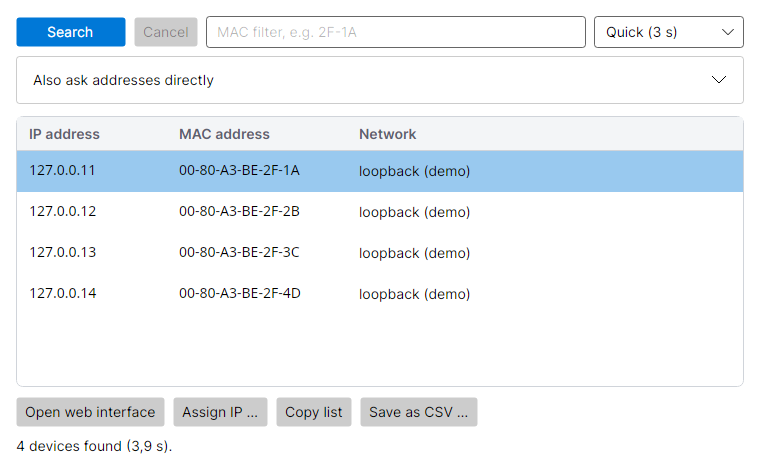

# Lantronix network tool

<p>
  
  <a href="https://github.com/TechnikWeber/lantronix-network-tool/releases/latest"></a>
  <a href="https://github.com/TechnikWeber/lantronix-network-tool/releases"></a>
  <a href="https://github.com/TechnikWeber/lantronix-network-tool/stargazers"></a>
  <a href="https://github.com/TechnikWeber/lantronix-network-tool/actions/workflows/ci.yml"></a>
  
  
  <a href="LICENSE"></a>
</p>

<p>
  <a href="https://github.com/TechnikWeber/lantronix-network-tool/releases/latest"><b>Download</b></a> &nbsp;·&nbsp;
  <a href="#command-line"><b>Command line</b></a> &nbsp;·&nbsp;
  <a href="#demo-without-hardware"><b>Demo without hardware</b></a> &nbsp;·&nbsp;
  <a href="https://github.com/TechnikWeber/lantronix-network-tool/releases"><b>Releases</b></a>
</p>

Finds Lantronix device servers (XPort, UDS, EDS, MSS, WiPort …) on the local network and
shows their IP and MAC addresses — the quick answer to “which IP did that box get?”. It
speaks the Lantronix discovery protocol (UDP port 30718), the same one DeviceInstaller uses.
Double-click a device to open its web interface. A device without a usable address gets a
temporary one the ARP way.



- **Search** asks every network adapter at once (LAN, Wi-Fi, VPN …), three broadcasts
  instead of a flood, results appear as they come in. Quick (3 s), thorough (10 s) or long
  (30 s, for a device you switch on during the search).
- **MAC filter** in any notation: `2F-1A`, `2f1a`, `00:80:A3:BE:2F:1A`.
- **Ask addresses directly** (unicast): `192.168.1.0/24`, `10.0.0.10-50` — works across
  routers and when a firewall drops the replies to a broadcast.
- **Assign IP** gives a device a temporary address: a static ARP entry plus a knock on
  port 1, then the tool checks that the device answers there. Needs administrator rights.
  The address lasts until the device restarts; set it permanently in the web interface or
  with `telnet <ip> 9999`. Works with the classic firmware (XPort, UDS, EDS, MSS, WiPort);
  some models only accept it while they have no IP address, Evolution OS devices (XPort
  EDGE, EDS3000, PremierWave) possibly not at all.
- Flags devices that sit in another subnet (they answer, but their web interface is out
  of reach) or have no IP address yet.
- Copy IP / MAC / telnet command, copy the list, save it as CSV.
- Light and dark mode, German or English after the system language.

> **Beta:** rewritten in 2026 and tested against the simulator only, not yet with real
> hardware. Reports from people with Lantronix devices are very welcome.

## Download and run

From the [latest release](https://github.com/TechnikWeber/lantronix-network-tool/releases/latest):

| System | File | Notes |
|---|---|---|
| Windows 10/11 | `lantronix-network-tool-…-windows-x64.exe` | Not signed: SmartScreen may warn (*More info › Run anyway*). Allow network access when Windows asks. |
| Linux | `…-x86_64.AppImage` | `chmod +x` and start, or via Gear Lever. |
| Fedora | `…x86_64.rpm` | `sudo dnf install ./lantronix-network-tool-*.rpm` (uses Fedora's .NET runtime). |
| macOS 12+ | `…-macos-arm64.zip` (Apple silicon), `…-macos-x64.zip` (Intel) | Not notarised: on first start right-click the app › *Open*. |

No .NET installation needed except for the RPM.

**Linux and firewalls:** the reply comes from the device's own address, not from the
broadcast address the query went to, so firewalld or ufw may drop it. If nothing shows up,
allow the replies (until the next reboot) with
`sudo firewall-cmd --add-source-port=30718/udp`, or ask the subnet directly
(“Also ask addresses directly”, e.g. `192.168.1.0/24`).

## Command line

`lantronix-scan` does the same on the command line — for scripts, servers and a
Raspberry Pi. Downloads for Windows, Linux (x64, arm64) and macOS are in the release; the
RPM and the AppImage (`./lantronix-network-tool-….AppImage scan …`) include it.

```text
$ lantronix-scan
IP address       MAC address        Network
192.168.1.20     00-80-A3-BE-2F-1A  enp3s0
192.168.1.21     00-80-A3-BE-2F-2B  enp3s0
2 devices found.

$ lantronix-scan --mac 2f1a --json --first
$ lantronix-scan --target 192.168.5.0/24 --no-broadcast --csv
$ sudo lantronix-scan assign --mac 00-80-A3-BE-2F-1A --ip 192.168.1.50
```

Exit code 0 when something was found, 1 when not, 2 for wrong options.
`lantronix-scan --help` lists everything.

### As a library

`src/Lantronix.Discovery` is a small .NET library without dependencies:

```csharp
await foreach (var d in Scanner.ScanAsync(new ScanOptions { MacFilter = "2F-1A" }))
    Console.WriteLine($"{d.Address} {d.MacText}");
```

## The protocol

Query `00 00 00 F6` to UDP 30718, as broadcast or unicast. Devices answer with 30 bytes
starting `00 00 00 F7`; bytes 24–29 are the MAC address. The tool hands out the whole
reply (`reply` in JSON/CSV) because the other bytes are not publicly documented — if you
know what they mean, please open an issue.

## Demo without hardware

`python3 demo/fake_devices.py` simulates four devices on your own machine — that is how
the screenshot above was made.

## Build

.NET 10 SDK; the window uses [Avalonia](https://avaloniaui.net/).

```sh
dotnet test --project tests/Lantronix.Discovery.Tests
dotnet run --project src/LantronixTool          # the window
dotnet run --project src/LantronixScan -- --help
LANTRONIX_LANG=en dotnet run --project tools/Screenshot -- docs/screenshot.png --search
```

Version 1.x was a Windows-only WinForms program (2018); it is still in the
[v1.0.1 release](https://github.com/TechnikWeber/lantronix-network-tool/releases/tag/v1.0.1).

## License

[MIT](LICENSE).
