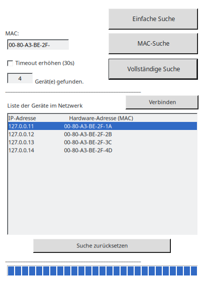

# Lantronix Netzwerk Tool



## Deutsch

Kleines Windows-Tool (C#, WinForms), das Lantronix-Geräte per UDP-Broadcast (Port 30718) im lokalen Netzwerk findet und IP- und MAC-Adresse anzeigt. Man kann alle Geräte suchen oder gezielt nach einer MAC-Adresse. Mit „Verbinden“ öffnet sich die Weboberfläche des ausgewählten Geräts im Browser.

**Starten:** `Lantronix Netzwerk Tool/Lantronix Netzwerk Tool/bin/Debug/Lantronix Netzwerk Tool.exe` unter Windows öffnen oder die Solution in Visual Studio bauen. Unter Linux läuft das Programm mit Mono:

```bash
mono "Lantronix Netzwerk Tool/Lantronix Netzwerk Tool/bin/Debug/Lantronix Netzwerk Tool.exe"
```

**Demo ohne Hardware:** `python3 demo/fake_devices.py` simuliert vier Geräte auf dem eigenen Rechner. Damit ist auch der Screenshot oben entstanden.

## English

Small Windows tool (C#, WinForms) that finds Lantronix devices on the local network via UDP broadcast (port 30718) and shows their IP and MAC addresses. You can search for all devices or for one specific MAC address. "Verbinden" (connect) opens the web interface of the selected device in your browser.

**Run:** open `Lantronix Netzwerk Tool/Lantronix Netzwerk Tool/bin/Debug/Lantronix Netzwerk Tool.exe` on Windows, or build the solution in Visual Studio. On Linux it runs with Mono:

```bash
mono "Lantronix Netzwerk Tool/Lantronix Netzwerk Tool/bin/Debug/Lantronix Netzwerk Tool.exe"
```

**Demo without hardware:** `python3 demo/fake_devices.py` simulates four devices on your own machine. The screenshot above was taken this way.

## Lizenz / License

MIT
