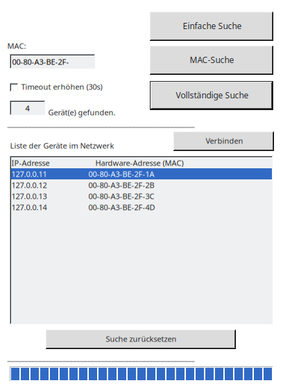

# Lantronix network tool

  
  
  
  
  
  

  <a href="https://github.com/TechnikWeber/lantronix-network-tool/releases/latest"><b>Download</b></a> &nbsp;·&nbsp;
  <a href="#demo-without-hardware"><b>Demo without hardware</b></a> &nbsp;·&nbsp;
  <a href="https://github.com/TechnikWeber/lantronix-network-tool/releases"><b>Releases</b></a>

A small Windows tool (C#, WinForms) that finds Lantronix devices on the local network with
the Lantronix discovery protocol (UDP broadcast, port 30718) and shows their IP and MAC
addresses. Search for all devices or for one specific MAC address; "Verbinden" (connect)
opens the web interface of the selected device in your browser. The interface is in German.

## Download and run

Get `lantronix-network-tool.exe` from the
[latest release](https://github.com/TechnikWeber/lantronix-network-tool/releases/latest).

- **Windows 10/11:** just start it. The file is not signed; SmartScreen may warn
  (*More info › Run anyway*).
- **Linux:** run it with Mono: `mono lantronix-network-tool.exe`. Install Mono once with
  `sudo apt install mono-complete` (Debian/Ubuntu) or `sudo dnf install mono-complete` (Fedora).

Or build the solution in Visual Studio.

## Demo without hardware

`python3 demo/fake_devices.py` simulates four devices on your own machine — that is how the
screenshot above was made.

## License

[MIT](LICENSE).
